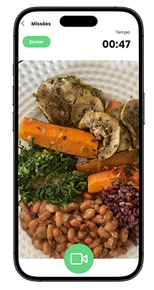
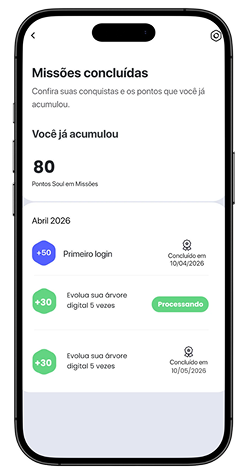
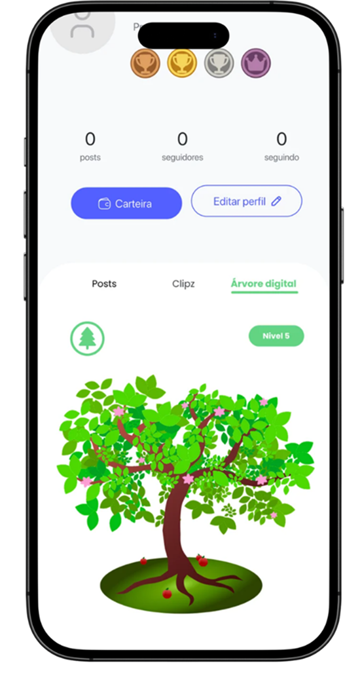
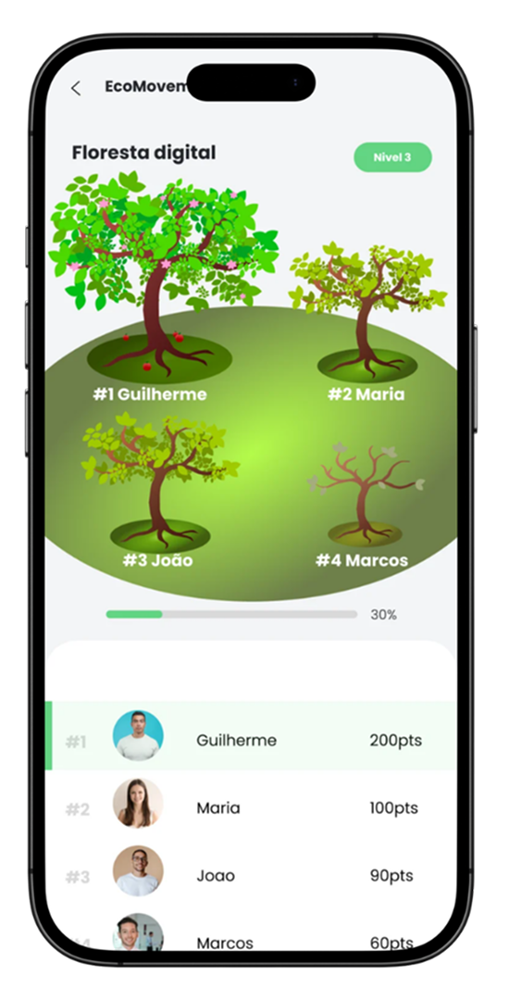

# EcoMovement

EcoMovement é uma plataforma de **sustentabilidade gamificada** criada para o ecossistema **SoulUp**. A aplicação transforma ações sustentáveis do dia a dia em **missões**, **Pontos Soul**, progresso na **árvore digital** e impacto coletivo na **floresta da comunidade**. Toda evidência enviada passa pelo **EcoGuard**, a camada antifraude que valida cada missão.

Projeto desenvolvido para a disciplina de **Front-End Design Engineering** (FIAP · Sprint 04), com integração à API desenvolvida em **Domain Driven Design Using Java**.

<p align="center">
  
  
  
  
</p>

## Como usar

| | Link |
|---|---|
| Repositório no GitHub | https://github.com/zanfolim07/Projeto-EcoMovement |
| Vídeo de apresentação (YouTube) | _adicionar link do vídeo_ |
| Aplicação na Vercel | https://projetoecomovement.vercel.app |
| API Java (publicada) | https://ecomovement-api.onrender.com |
| Repositório da API Java | https://github.com/FabioCAlmeida/EcoMovement-API |

### Fazendo uma missão

1. Clique no **ícone de missão** no canto inferior direito de qualquer página (ao passar o mouse aparece “Fazer missão”). Em **Missões** (`/missoes`) também dá para ver a lista de missões vinda da API e abrir o detalhe de cada uma (`/missoes/:missaoId`).
2. Escolha uma missão EcoMovement e clique em **Começar**.
3. Leia as informações e clique em **Continuar**.
4. Grave o vídeo ou tire a foto **na hora**, pela câmera aberta dentro do site. Não é possível enviar arquivos da galeria. O cronômetro de **2 minutos** começa assim que a câmera abre e continua correndo se você refizer a evidência.
5. Clique em **Enviar**. A evidência fica **em análise** e aparece em **Missões concluídas**.

### Fazendo o quiz

1. No painel de missões, clique em **Começar** na missão **Complete o quiz EcoMovement** (+100 Pontos Soul).
2. Responda as 5 perguntas sobre sustentabilidade. Cada acerto vale **20 Pontos Soul**, somados na hora.
3. Você tem **2 vidas**: cada erro tira uma. Se as vidas acabarem, os pontos dos acertos ficam com você.
4. São **2 tentativas**. Na segunda, **Tentar de novo** traz só as perguntas que faltaram. Sair do quiz no meio também conta como uma tentativa.
5. Ao acertar as 5, ou quando as tentativas acabam, a missão aparece como concluída.

> O quiz não depende da API: o progresso fica salvo no navegador e **Reiniciar teste** também zera o quiz.

### Executando localmente (passo a passo)

A aplicação completa tem três partes: o **banco Oracle**, a **API Java** e este **site React**.
Siga na ordem abaixo.

**O que você precisa instalado**

- [Node.js](https://nodejs.org) 20 ou mais novo (para o site)
- [Java JDK](https://adoptium.net) 21 ou mais novo e [Maven](https://maven.apache.org) (para a API)
- [Oracle SQL Developer](https://www.oracle.com/database/sqldeveloper/) e um usuário do Oracle (ex.: o da FIAP)

**1. Banco de dados (só na primeira vez)**

1. Baixe o projeto da API (link do repositório na tabela acima).
2. Abra o SQL Developer e conecte no Oracle (`oracle.fiap.com.br`, porta `1521`, SID `ORCL`, com o seu RM e senha).
3. Em **Arquivo → Abrir**, rode com **F5**, nesta ordem, os scripts da pasta `database/` da API:
   - `01_alteracoes_mer.sql` (só uma vez)
   - `02_carga_dados.sql` (cria as missões, os usuários e o login do admin)

> O SQL Developer não precisa ficar aberto depois. O banco fica no servidor da FIAP.

**2. Iniciar a API Java**

Na pasta da API, copie o `.env.example` para `.env`, coloque o seu usuário e senha do Oracle e rode:

```bash
cp .env.example .env
mvn spring-boot:run
```

Espere aparecer `Started EcomovementApplication` e confira em http://localhost:8080 (deve mostrar `"status": "online"`).
Deixe esse terminal aberto enquanto usa o site.

**3. Iniciar o site**

Em outro terminal, na pasta deste projeto:

```bash
npm install
cp .env.example .env.local
```

Abra o `.env.local` e coloque o endereço da API:

```
VITE_API_URL=http://localhost:8080
VITE_USUARIO_ID=1
```

Depois rode:

```bash
npm run dev
```

Abra **http://localhost:5173**.

> A API só aceita o site na porta **5173**. Se o Vite abrir em outra porta, feche o programa que estiver usando a 5173 e rode de novo.
> Sem o `.env.local`, o site usa a API publicada (https://ecomovement-api.onrender.com). Para usar os dados de demonstração (sem salvar no banco), deixe `VITE_API_URL=` vazio.

**4. Testar o fluxo completo**

1. Em **Missões**, clique em **Fazer uma missão**, escolha uma missão de foto ou vídeo e envie a evidência pela câmera.
2. Abra **http://localhost:5173/admin** e entre com `ecomovement@admin.com` / senha `1234`.
3. Em **Em análise**, veja a foto ou o vídeo enviado e clique em **Aprovar**.
4. Volte em **Missões**: a missão aparece como concluída e os Pontos Soul aumentam.

Para ver os dados salvos no banco, rode o `database/03_consultas.sql` da API no SQL Developer.

Outros comandos:

```bash
npm run build   # checagem de tipos + build de produção
npm run lint    # análise estática com oxlint
npm run preview # serve o build localmente
```

## Integração com a API

A comunicação com o back-end fica em `src/services`. A URL da API é definida pela variável de ambiente `VITE_API_URL` (no `.env` local e nas *Environment Variables* da Vercel).

Se `VITE_API_URL` não for definida, o site usa a API publicada (`https://ecomovement-api.onrender.com`). Se ela for definida vazia (`VITE_API_URL=`), o site funciona com **dados de demonstração** (`src/data/missoes.ts`), no mesmo formato que a API devolve.

Como a API está no plano gratuito do Render, o servidor hiberna depois de um tempo sem uso. Quando uma requisição demora mais de 4 segundos, o site mostra o aviso **“Conectando ao servidor…”** (componente `AvisoConexao` + hook `useDemora`) junto com o carregamento.

| Método | Endpoint | Uso no front | Corpo / resposta |
|---|---|---|---|
| GET | `/missoes?usuarioId={id}` | Lista de missões do painel e da página Missões | `Missao[]` |
| GET | `/missoes/{id}?usuarioId={id}` | Página de detalhe da missão (`/missoes/:missaoId`) | `Missao` (404 se não existir) |
| GET | `/usuarios/{id}/submissoes` | Missões concluídas / em análise | `Submissao[]` |
| GET | `/usuarios/{id}/pontos` | Total de Pontos Soul | `{ "total": 80 }` |
| POST | `/submissoes` | Envio da evidência | `multipart/form-data`: `usuarioId`, `missaoId`, `tipoEvidencia` (`VIDEO`/`FOTO`), `duracaoSegundos`, `arquivo` → `Submissao` |
| DELETE | `/usuarios/{id}/submissoes` | Reiniciar teste | — |
| GET | `/ranking` | Ranking das missões | `PosicaoRanking[]` |
| POST | `/contatos` | Formulário de contato (salva a mensagem no banco) | JSON `{ nome, email, mensagem }` |
| POST | `/admin/login` | Login do Painel EcoGuard | JSON `{ email, senha }` → `AdminLogado` |
| GET | `/submissoes?status={status}` | Lista de envios no painel admin | `Submissao[]` |
| PUT | `/submissoes/{id}/aprovar` e `/submissoes/{id}/rejeitar` | Avaliação da evidência | `Submissao` |
| DELETE | `/submissoes/{id}` | Exclusão de um envio | — |
| GET | `/submissoes/{id}/evidencia` | Foto ou vídeo da evidência | arquivo |

Os tipos estão em `src/types/index.ts`:

- `Missao`: `id`, `titulo`, `descricao`, `instrucoes`, `pontos`, `tipoEvidencia` (`VIDEO` \| `FOTO` \| `AUTOMATICA`; `QUIZ` só no front), `meta`, `progresso`, `status` (`DISPONIVEL` \| `EM_PROGRESSO` \| `EM_ANALISE` \| `CONCLUIDA`), `categoria`, `dificuldade` (`FACIL` \| `MEDIA` \| `DIFICIL`), `tempoMaximoSegundos`.
- `Submissao`: `id`, `missaoId`, `titulo`, `pontos`, `status` (`EM_ANALISE` \| `APROVADA` \| `REJEITADA`), `duracaoSegundos`, `enviadaEm`, `concluidaEm`, `evidenciaUrl`.

> A API Java precisa liberar **CORS** para o domínio da Vercel. A câmera só funciona em `localhost` ou em HTTPS (como na Vercel).

## Tecnologias utilizadas

- React 19 + Vite + TypeScript
- React Router DOM (SPA com rotas dinâmicas)
- Context API (`useContext`) + hooks `useState` e `useEffect`
- React Hook Form (validação do formulário de contato)
- Tailwind CSS v4
- React Icons
- Fetch API (requisições HTTP), getUserMedia + MediaRecorder (câmera e gravação da evidência na hora)
- oxlint
- Vercel (deploy)

## Funcionalidades

- **Missões EcoMovement**: botão flutuante em todas as páginas que abre o painel de missões com filtros, informações, câmera dentro do site (vídeo com cronômetro de 2 minutos ou foto, sempre registrados na hora, sem galeria), envio, confirmação e histórico de missões concluídas com Pontos Soul.
- **Detalhe da missão** (`/missoes/:missaoId`): busca a missão na API pelo id, com carregamento, mensagem de erro com “Tentar novamente” e página de “Missão não encontrada” para ids inválidos ou inexistentes.
- **Quiz EcoMovement**: missão com 5 perguntas sobre sustentabilidade, 20 Pontos Soul por acerto, 2 vidas e 2 tentativas.
- **Ranking** das missões com pódio e posição do usuário.
- **Solução do projeto**: galeria das telas do protótipo com filtro por categoria, além da evolução da árvore digital e da floresta/ranking.
- **Integrantes**: cards com foto, nome, RM, turma, GitHub e LinkedIn; cada card leva ao perfil do integrante (`/integrantes/:memberId`).
- **Sobre**, **FAQ** (por categoria, com atalhos) e **Contato** (React Hook Form com validação dos campos e envio para a API, que salva a mensagem no banco).
- Página 404 para rotas inexistentes.
- Layout responsivo com os breakpoints do Tailwind (`sm:`, `md:`, `lg:` e `xl:`) para mobile (até 480px), tablet (768px), desktop (992px+) e telas grandes (1280px+).

## Rotas

| Rota | Página |
|---|---|
| `/` | Home (boas-vindas) |
| `/inicio` | Início do EcoMovement |
| `/sobre` | Sobre o projeto |
| `/missoes` | Lista de missões (API) e guia de como participar |
| `/missoes/:missaoId` | Detalhe de uma missão (API) |
| `/solucao` | Solução do projeto (galeria) |
| `/faq` | Perguntas frequentes |
| `/contato` | Contato |
| `/integrantes` | Equipe |
| `/integrantes/:memberId` | Perfil do integrante |
| `/admin` | Painel EcoGuard (login de administrador e análise das evidências) |
| `*` | Página não encontrada |

## Estrutura de pastas

```text
src/
  assets/            imagens e ícones do projeto
  components/        componentes reutilizáveis
    AvisoConexao/  Button/  Card/  Footer/  Header/  Layout/
    InfoList/  MemberCard/  PageHero/  ScreenFigure/  ScrollToTop/
    SectionHeader/  TelaSolucaoCard/
    Missoes/         botão flutuante, telas do fluxo de missões, quiz e ranking
  context/           contexto global das missões (useContext)
  data/              dados estáticos (integrantes, FAQ, sobre, telas, missões, quiz)
  hooks/             hooks próprios (useMissoes, usePageTitle, useDemora)
  Pages/             páginas da aplicação
  services/          comunicação com a API (fetch) e dados de demonstração
  types/             tipos TypeScript compartilhados
  utils/             funções de formatação
  App.tsx            rotas
  main.tsx           ponto de entrada
  index.css          tema do Tailwind
```

## Imagens e ícones

| Missões | Árvore digital | Floresta digital | Ranking |
|---|---|---|---|
|  |  |  |  |

<p>
  
  
  
  
  
</p>

Os ícones de interface vêm da biblioteca [React Icons](https://react-icons.github.io/react-icons/) (Lucide e Font Awesome).

## Autores e créditos

| Foto | Nome | RM | Turma | GitHub | LinkedIn |
|---|---|---|---|---|---|
|  | Guilherme Zanfolim Nunes Farias | RM 570983 | 1TDSPV | [zanfolim07](https://github.com/zanfolim07) | [LinkedIn](https://www.linkedin.com/in/guilherme-zanfolim-202865315) |
|  | Lucas Monteiro Dias da Costa | RM 571388 | 1TDSPV | [monteiroo5](https://github.com/monteiroo5) | [LinkedIn](https://www.linkedin.com/in/lucas-monteiro-1110703b5/) |
|  | Jaime Ringel | RM 562044 | 1TDSPV | [jaimeringel004](https://github.com/jaimeringel004) | [LinkedIn](https://www.linkedin.com/in/jaime-ringel-1060bb402) |
|  | Fabio Cezare Almeida | RM 572642 | 1TDSPV | [FabioCAlmeida](https://github.com/FabioCAlmeida) | [LinkedIn](https://www.linkedin.com/in/fabio-cezare-almeida-4b448a408) |
|  | Matheus Magalhães Romão de Moraes | RM 573371 | 1TDSPV | [MagalhaesMatheus007](https://github.com/MagalhaesMatheus007) | [LinkedIn](https://www.linkedin.com/in/matheus-magalh%C3%A3es-ti) |

Projeto acadêmico desenvolvido na FIAP em parceria com a SoulUp (Prospera).

## Contato

- **Formulário:** página **Contato** da aplicação (`/contato`), que salva a mensagem no banco pela API.
- **E-mail da equipe:** _adicionar e-mail de contato_
- **GitHub do projeto:** https://github.com/zanfolim07/Projeto-EcoMovement
- **Integrantes:** links de GitHub e LinkedIn de cada um na tabela de [Autores e créditos](#autores-e-créditos).